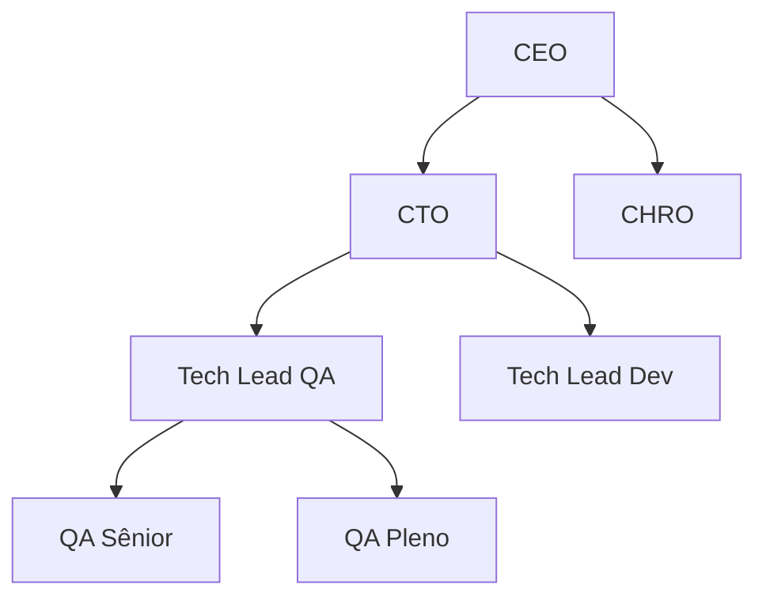
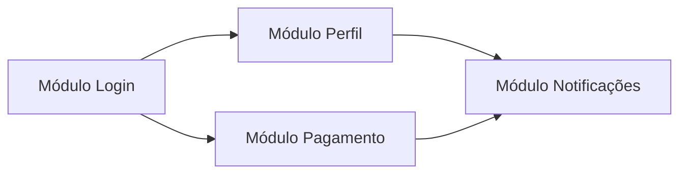

## 🔷 Estruturas de Dados: O que são e por que importam

Pense assim: **Estruturas de dados são como "organizadores" para seus dados**.  
Assim como você tem **pastas, gavetas e caixas** para organizar coisas em casa, no computador você tem **arrays, listas, dicionários** etc.

✅ **No seu contexto (RH + QA)**:

- **Lista** → candidatos em uma vaga
- **Dicionário** → perfil do candidato (nome, email, skills)
- **Fila** → ordem de triagem de bugs
- **Pilha** → histórico de status de um bug

---

## 🔷 As principais estruturas (do simples ao complexo)

### ✅ **1. Array/Vetor** (mais básico)

- **Como funciona**: Caixinhas numeradas (0, 1, 2, 3...)
- **Acesso rápido** por posição
- **Tamanho fixo** (geralmente)

```python
# Exemplo: Lista de candidatos para uma vaga
candidatos = ["Ana", "Bruno", "Carla", "Daniel"]
# Ana está na posição 0, Bruno na 1, etc.
```

**Quando usar (RH)**: Lista fixa de etapas do processo ("inscrição", "triagem", "entrevista")

---

### ✅ **2. Lista Ligada (Linked List)**

- **Como funciona**: Cada item aponta para o próximo (como um trem)
- **Inserir/remover no meio** é rápido
- **Buscar** é mais lento (tem que percorrer)


**Quando usar (QA)**: Histórico de um bug (cada status aponta para o próximo)

---

### ✅ **3. Pilha (Stack)**

- **Como funciona**: **LIFO** (Last In, First Out) → último a entrar, primeiro a sair
- Como uma **pilha de pratos** ou **histórico do Ctrl+Z**

```python
# Exemplo: Histórico de status de um bug
historico_bug = []
historico_bug.append("aberto")      # empilha
historico_bug.append("em análise")
historico_bug.append("corrigido")
ultimo_status = historico_bug.pop() # tira o último → "corrigido"
```

**Quando usar**:

- QA: Ctrl+Z em edição de casos de teste
- RH: Desfazer última ação no ATS

---

### ✅ **4. Fila (Queue)**

- **Como funciona**: **FIFO** (First In, First Out) → primeiro a entrar, primeiro a sair
- Como uma **fila de banco** ou **pedidos no iFood**

```python
# Exemplo: Triagem de bugs por prioridade
bugs_para_triar = []
bugs_para_triar.append("bug_critico")  # entra na fila
bugs_para_triar.append("bug_medio")
proximo_bug = bugs_para_triar.pop(0)   # sai o primeiro → "bug_critico"
```

**Quando usar**:

- QA: Ordem de execução de testes
- RH: Candidatos aguardando entrevista

---

### ✅ **5. Dicionário/Hash Map**

- **Como funciona**: **Chave → Valor** (como um dicionário real)
- **Busca super rápida** pela chave

```python
# Exemplo: Perfil completo do candidato
candidato = {
    "nome": "Bruno Silva",
    "email": "bruno@email.com",
    "vaga": "QA Analyst",
    "status": "em entrevista",
    "entrevistas": 3
}
# Acesso rápido: candidato["email"] → "bruno@email.com"
```

**Quando usar**:

- RH: Banco de candidatos (buscar por email/ID)
- QA: Configurações de teste (parâmetro → valor)

---

### ✅ **6. Árvore (Tree)**

- **Como funciona**: Hierarquia (pai → filhos)
- Como **organograma** ou **estrutura de pastas**



**Quando usar**:

- RH: Estrutura organizacional
- QA: Categorização de testes (suíte → caso → passo)

---

### ✅ **7. Grafo (Graph)**

- **Como funciona**: Nós conectados por arestas (relações)
- Como **rede social** ou **dependências entre módulos**



**Quando usar**:

- QA: Dependências entre bugs/testes
- RH: Rede de indicações entre candidatos

---

## 🔷 Comparação rápida (quando usar cada uma)

|Estrutura|Força|Fraqueza|Exemplo RH|Exemplo QA|
|---|---|---|---|---|
|**Array**|Acesso rápido por posição|Tamanho fixo, inserção lenta|Lista de etapas fixas|Configurações de ambiente|
|**Lista Ligada**|Inserção/remoção rápida|Busca lenta|Histórico de feedbacks|Log de execução|
|**Pilha**|Último entra, primeiro sai|Só acessa o topo|Ctrl+Z no processo|Rollback de deploy|
|**Fila**|Primeiro entra, primeiro sai|Só acessa o início|Fila de entrevistas|Ordem de execução de testes|
|**Dicionário**|Busca ultra rápida por chave|Ordem não garantida|Banco de candidatos|Configurações por chave|
|**Árvore**|Hierarquia natural|Complexa de manter|Organograma|Estrutura de testes|
|**Grafo**|Relações complexas|Mais complexa ainda|Rede de indicações|Dependências entre bugs|

---

## 🔷 Como isso se conecta com SQL/Banco de Dados

No banco de dados, você **usa** essas estruturas sem perceber:

- **Tabela** → Array de linhas
- **Chave primária** → Índice de dicionário (busca rápida)
- **JOIN** → Conectando grafos/árvores
- **ORDER BY** → Ordenando arrays
- **GROUP BY** → Agrupando em dicionários

```sql
-- No fundo, o banco usa estruturas de dados para isso:
SELECT * FROM candidatos WHERE email = 'bruno@email.com'
-- ↑ O banco usa um "dicionário" (índice) para buscar rápido
```

---

## 🔷 Exercício prático (pensamento analítico)

**Cenário RH**: Você tem 1000 candidatos para triagem.

**Pergunta**: Qual estrutura usar para:

1. Manter a **ordem de chegada**? → **Fila**
2. Buscar **rápido por CPF**? → **Dicionário**
3. Manter **histórico de status** (com possibilidade de desfazer)? → **Pilha**
4. Representar **relação de indicações**? → **Grafo**

**Cenário QA**: Sistema de bugs.

**Pergunta**: Qual estrutura para:

1. **Prioridade** (críticos primeiro)? → **Fila com prioridade**
2. **Buscar bug por ID**? → **Dicionário**
3. **Histórico de mudanças**? → **Pilha**
4. **Dependências entre bugs**? → **Grafo**