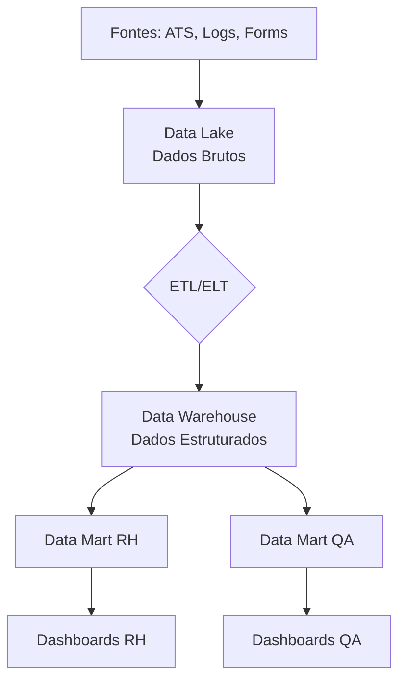

## 🔷 Arquitetura Analítica: O que é e por que importa

Pense assim: **Arquitetura analítica é como a "planta baixa" de uma fábrica de insights**.  
Assim como uma fábrica tem **linhas de produção, estoques, controle de qualidade**, um sistema analítico tem **fontes de dados, processamento, armazenamento, visualização**.

✅ **No seu contexto (RH + QA)**:

- **Fontes**: ATS, LinkedIn, formulários, logs de bugs, resultados de testes
- **Processamento**: Limpar dados, calcular métricas, identificar padrões
- **Armazenamento**: Banco de dados, data warehouse
- **Visualização**: Dashboards de RH, relatórios de qualidade

---

## 🔷 Os 4 pilares da arquitetura analítica

### ✅ **1. Coleta de Dados (Data Ingestion)**

**O que é**: Pegar dados de várias fontes e trazer para o sistema.

**Fontes comuns**:

- **RH**: ATS, pesquisas de satisfação, LinkedIn, formulários
- **QA**: Logs de aplicação, resultados de testes, feedback de usuários, Jira

**Técnicas**:

- **Batch**: Coleta em lotes (diário, semanal)
- **Streaming**: Dados em tempo real (logs, cliques)

**Exemplo prático (RH)**:

```sql
-- Dados batch do ATS (importação diária)
INSERT INTO candidatos_ats
SELECT * FROM arquivo_csv_ats
WHERE data_importacao = CURRENT_DATE;
```

---

### ✅ **2. Processamento e Transformação (ETL/ELT)**

**O que é**: Limpar, organizar e preparar os dados para análise.

**ETL vs ELT**:

- **ETL**: Extrair → Transformar → Carregar (transforma ANTES de salvar)
- **ELT**: Extrair → Carregar → Transformar (transforma DEPOIS de salvar)

**Exemplo (QA) - Limpeza de logs**:

```sql
-- Transformação: classificar bugs automaticamente
UPDATE bugs
SET severidade = 
  CASE 
    WHEN descricao ILIKE '%crash%' OR descricao ILIKE '%bloqueante%' THEN 'critico'
    WHEN descricao ILIKE '%erro%' AND descricao ILIKE '%funcionalidade%' THEN 'alto'
    ELSE 'medio'
  END
WHERE severidade IS NULL;
```

---

### ✅ **3. Armazenamento (Data Storage)**

**O que é**: Onde os dados ficam guardados para análise.

**Camadas típicas**:

|Camada|Para que serve|Exemplo|
|---|---|---|
|**Data Lake**|Dados brutos (tudo)|Logs crus, arquivos JSON, vídeos|
|**Data Warehouse**|Dados estruturados para BI|Tabelas de RH/QA organizadas|
|**Data Mart**|Dados específicos por área|Somente dados de recrutamento|
|**OLAP Cubes**|Análise multidimensional|Cubo de turnover por departamento/mês|

**Visual da arquitetura**:



---

### ✅ **4. Consumo e Visualização (Consumption Layer)**

**O que é**: Como as pessoas vão usar os dados.

**Ferramentas**:

- **BI**: Power BI, Tableau, Metabase
- **Relatórios**: SQL direto, Python notebooks
- **APIs**: Dados para outros sistemas

**Exemplo dashboard RH**:

```
📊 FUNIL DE RECRUTAMENTO - JAN/2026
──────────────────────────────
Inscrições: 1.250
Triagem: 850 (68%)
Entrevistas: 425 (34%)
Propostas: 127 (10%)
Contratações: 89 (7%)
──────────────────────────────
Gargalo: Triagem → Entrevista (-50%)
```

---

## 🔷 Arquiteturas modernas (do simples ao complexo)

### ✅ **Arquitetura Tradicional (Monolítica)**

- **Como**: Tudo no mesmo banco (PostgreSQL/MySQL)
- **Prós**: Simples, barato
- **Contras**: Não escala, mistura operacional com analítico

```sql
-- Tudo junto (não ideal para grandes volumes)
SELECT * FROM candidatos 
WHERE data_inscricao >= '2026-01-01';
```

---

### ✅ **Arquitetura Lambda (Batch + Streaming)**

- **Como**: Dois caminhos paralelos
- **Batch**: Para dados históricos (ETL noturno)
- **Streaming**: Para dados em tempo real

**Exemplo QA**:

- **Batch**: Relatório diário de bugs
- **Streaming**: Alerta imediato quando bug crítico aparece

---

### ✅ **Arquitetura Kappa (Só Streaming)**

- **Como**: Tudo como streaming, replay quando necessário
- **Prós**: Mais simples que Lambda
- **Contras**: Requer sistemas robustos

---

## 🔷 Exemplo prático: Arquitetura para RH Analytics

### **Componentes**:

1. **Fontes**:
    
    - ATS (PostgreSQL)
    - LinkedIn API (JSON)
    - Pesquisas (Google Forms → CSV)
2. **Ingestão**:
    
    - Airflow (orquestração)
    - Kafka (streaming de eventos)
3. **Armazenamento**:
    
    - Data Lake (S3/MinIO): dados brutos
    - Data Warehouse (Snowflake/BigQuery): dados limpos
    - Data Mart RH (PostgreSQL): dados específicos
4. **Processamento**:
    
    - dbt (transformações)
    - Python (limpeza avançada)
5. **Visualização**:
    
    - Metabase (dashboards)
    - API REST (integração com outros sistemas)

---

## 🔷 Exemplo prático: Arquitetura para QA Analytics

### **Componentes**:

1. **Fontes**:
    
    - Jira/Zephyr (bugs, testes)
    - Jenkins/GitLab CI (builds)
    - Logs de aplicação
2. **Ingestão**:
    
    - Fluentd/Logstash (coleta de logs)
    - API calls (resultados de testes)
3. **Armazenamento**:
    
    - Elasticsearch (logs para busca)
    - PostgreSQL (dados estruturados)
    - Data Lake (dados brutos de execução)
4. **Processamento**:
    
    - Spark (agregação de grandes volumes)
    - Python (análise estatística)
5. **Visualização**:
    
    - Grafana (métricas em tempo real)
    - Power BI (relatórios gerenciais)

---

## 🔷 Checklist: Como projetar sua arquitetura

### ✅ **Perguntas para fazer**:

1. **Volume**: Quantos dados? (MB, GB, TB por dia?)
2. **Velocidade**: Tempo real ou batch?
3. **Variedade**: Dados estruturados, semi-estruturados, não estruturados?
4. **Orçamento**: Quanto pode gastar?
5. **Habilidade da equipe**: Quem vai manter?

### ✅ **Decisões técnicas**:

- **Cloud vs On-premise**? → Cloud (mais flexível)
- **SQL vs NoSQL**? → SQL para RH/QA (dados estruturados)
- **Batch vs Streaming**? → Comece com batch, evolua para streaming

---

## 🔷 Caso concreto: Sistema de Analytics para RH + QA

### **Requisitos**:

- 10.000 candidatos/mês
- 5.000 bugs/mês
- Dashboards atualizados diariamente
- Alertas em tempo real para bugs críticos

### **Arquitetura sugerida**:

```
📥 INGESTÃO
├── PostgreSQL (ATS, bugs)
├── CSV imports (pesquisas)
└── API (LinkedIn, Jira)

🔄 PROCESSAMENTO  
├── Airflow (orquestração diária)
├── dbt (transformações SQL)
└── Python (limpeza especializada)

💾 ARMAZENAMENTO
├── Data Lake (S3) → dados brutos
├── Data Warehouse (BigQuery) → dados limpos
├── PostgreSQL → data marts
└── Elasticsearch → logs

👁️ VISUALIZAÇÃO
├── Metabase → dashboards RH
├── Grafana → métricas QA tempo real
└── API → integração com outros sistemas
```