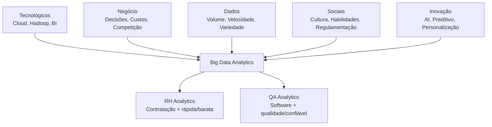

## 🔷 Drivers de Big Data Analytics: O que impulsiona a análise de dados em larga escala

Pense assim: **Drivers são os "motores" que fazem as empresas investirem em Big Data Analytics**.  
Assim como um carro precisa de gasolina, direção e estrada, a análise de dados precisa de **tecnologia, negócio e pessoas**.

✅ **No seu contexto (RH + QA)**:

- **Tecnológico**: Ferramentas que permitem analisar milhões de currículos/bugs
- **Negócio**: Reduzir custos de contratação, melhorar qualidade do software
- **Pessoas**: Você (analista) precisando tomar decisões baseadas em dados

---

## 🔷 Os 5 principais drivers

### ✅ **1. Drivers Tecnológicos** (o que tornou possível)

**a) Armazenamento barato**

- Antes: `$10.000` por 1TB
- Hoje: `$20` por 1TB na nuvem
- **Impacto RH**: Guardar histórico completo de todos os candidatos
- **Impacto QA**: Armazenar todos os logs de erro por anos

**b) Processamento distribuído**

- Hadoop, Spark → processar terabytes em horas/minutos
- **Exemplo QA**: Analisar 1 milhão de execuções de teste overnight

**c) Cloud Computing**

- AWS, Google Cloud, Azure → escalar sob demanda
- **Exemplo RH**: Pico de contratações (final de ano) → escala automática

**d) Ferramentas de BI self-service**

- Power BI, Tableau, Metabase → analistas sem TI criam dashboards
- **Seu caso**: Você mesmo criar dashboards de RH/QA sem depender de programador

---

### ✅ **2. Drivers de Negócio** (o que justifica o investimento)

**a) Tomada de decisão baseada em dados**

- Antes: "Acho que contratamos bem"
- Agora: "Taxa de turnover reduziu 15% após mudar processo X"
- **Métrica RH**: Custo por contratação, tempo médio de preenchimento
- **Métrica QA**: Bugs por release, tempo médio de resolução

**b) Vantagem competitiva**

- Empresa A: Contrata em 45 dias
- Empresa B (com analytics): Contrata em 21 dias → ganha os melhores talentos

**c) Redução de custos**

- **RH**: Analytics identifica que entrevista técnica não prediz performance → elimina etapa, economiza `$50.000/ano`
- **QA**: Predictive analytics prevê módulos problemáticos → testa mais cedo, reduz bugs em produção 40%

**d) Novas fontes de receita**

- Dados de RH → vender insights para universidades (quais skills estão em alta)
- Dados de QA → produto como serviço (SaaS com analytics embutido)

---

### ✅ **3. Drivers de Dados** (o combustível)

**a) Volume explosivo**

- **RH**: LinkedIn (800M usuários), GitHub (100M devs), currículos digitais
- **QA**: Logs de microserviços, testes automatizados, monitoramento contínuo

**b) Velocidade (real-time)**

- **RH**: Candidato aplica → sistema já sugere compatibilidade
- **QA**: Bug aparece → alerta em segundos para equipe certa

**c) Variedade de fontes**

- **RH**: Texto (currículos), vídeo (entrevistas), áudio (feedback), gráficos (testes)
- **QA**: JSON (APIs), logs (texto), métricas (números), screenshots (evidências)

**d) Internet das Coisas (IoT)**

- **QA**: Dispositivos físicos gerando dados de uso real
- Exemplo: App de RH em smartwatch coleta dados de engajamento

---

### ✅ **4. Drivers Sociais/Organizacionais** (as pessoas)

**a) Cultura data-driven**

- Liderança que pede "mostre os dados" antes de decidir
- **RH**: "Não contrato sem ver analytics do candidato"
- **QA**: "Não release sem métricas de qualidade"

**b) Habilidades em alta**

- Sua transição para QA/Data → valorizada no mercado
- Salário de analista de dados +40% vs generalista

**c) Educação e treinamento**

- Sua pós-graduação → capacitando para essa demanda
- Cursos online (Coursera, Udacity) formando milhões

**d) Regulamentação e compliance**

- **RH**: LGPD → precisa controlar dados de candidatos
- **QA**: Normas (ISO, SOC2) → precisa provar qualidade com dados

---

### ✅ **5. Drivers de Inovação** (o futuro)

**a) Inteligência Artificial/Machine Learning**

- **RH**: ML prevê qual candidato terá melhor performance
- **QA**: AI detecta padrões em bugs antes de humanos

**b) Analytics preditivo e prescritivo**

- Não só "o que aconteceu" mas "o que vai acontecer" e "o que fazer"
- **RH**: "Candidato X tem 85% chance de aceitar oferta se adicionarmos benefício Y"
- **QA**: "Módulo Z terá 3 bugs críticos no próximo sprint → teste mais aqui"

**c) Personalização em escala**

- **RH**: Experiência única para cada candidato baseada em seus dados
- **QA**: Testes adaptativos baseados em histórico de falhas

---

## 🔷 Visual: Como os drivers se conectam

---

## 🔷 Casos reais (como os drivers aparecem na prática)

### **Caso RH: Contratação em escala na Amazon**

- **Driver tecnológico**: AWS (própria cloud)
- **Driver de dados**: Milhões de aplicações/ano
- **Driver de negócio**: Reduzir custo por contratação de `$5.000` para `$3.000`
- **Resultado**: Sistema automatizado tria 95% dos currículos

### **Caso QA: Microsoft Azure DevOps**

- **Driver tecnológico**: Azure Machine Learning
- **Driver de dados**: Bilhões de linhas de logs
- **Driver de inovação**: AI prevê falhas antes de acontecerem
- **Resultado**: 30% menos downtime em produção

---

## 🔷 Como esses drivers afetam SUA carreira

### ✅ **Oportunidades criadas**:

1. **Analista de People Analytics** → RH data-driven
2. **QA Engineer com foco em dados** → qualidade baseada em métricas
3. **Data Analyst especializado em RH/QA** → nicho valioso

### ✅ **Habilidades necessárias**:

- SQL (já está aprendendo)
- Python/R para análise
- Ferramentas de BI (Power BI, Tableau)
- Estatística básica
- Storytelling com dados

### ✅ **Salários (Brasil 2025)**:

- Analista de Dados JR: `R$ 4.000 - R$ 6.000`
- Analista de Dados PL: `R$ 7.000 - R$ 10.000`
- Analista de Dados SR: `R$ 11.000 - R$ 16.000`
- Especialista em People Analytics: `+20%` sobre esses valores

---

## 🔷 Exercício: Identifique drivers no seu dia

**Pegue uma situação real do RH ou QA e pergunte**:

1. **Tecnológico**: Que ferramenta permitiu isso?
2. **Negócio**: Que problema de negócio resolve?
3. **Dados**: Que dados são usados? Volume/velocidade/variedade?
4. **Social**: Quem precisa convencer? Que cultura existe?
5. **Inovação**: Tem AI/ML? É preditivo?

**Exemplo (triagem de currículos)**:

- Tecnológico: ATS com parsing de PDF
- Negócio: Reduzir tempo de triagem de 4h para 30min
- Dados: 500 currículos/semana (texto + PDF)
- Social: Recrutadores resistentes à automação
- Inovação: ML classifica "fit cultural" (futuro)

---

## 🔷 Tendências (drivers emergentes)

### ✅ **2025-2026**:

1. **AI Generativa** no RH: ChatGPT para escrever descrições de vaga
2. **Real-time analytics** em QA: Monitoramento contínuo de produção
3. **Ethical AI**: Viés em algoritmos de contratação
4. **Data Mesh**: Dados como produto (cada área dona dos seus dados)

### ✅ **Para você focar**:

1. **SQL avançado** (já está)
2. **Python básico** para automação
3. **Power BI/Metabase** para dashboards
4. **Estatística** para validar insights

---

## 🔷 Resumo

- **Big Data Analytics não é só tecnologia** → é negócio + dados + pessoas
- **Você está no lugar certo** → RH/QA são áreas ricas em dados
- **Os drivers criam demanda** por profissionais como você
- **Comece simples** → PostgreSQL + SQL → evolua conforme necessidade